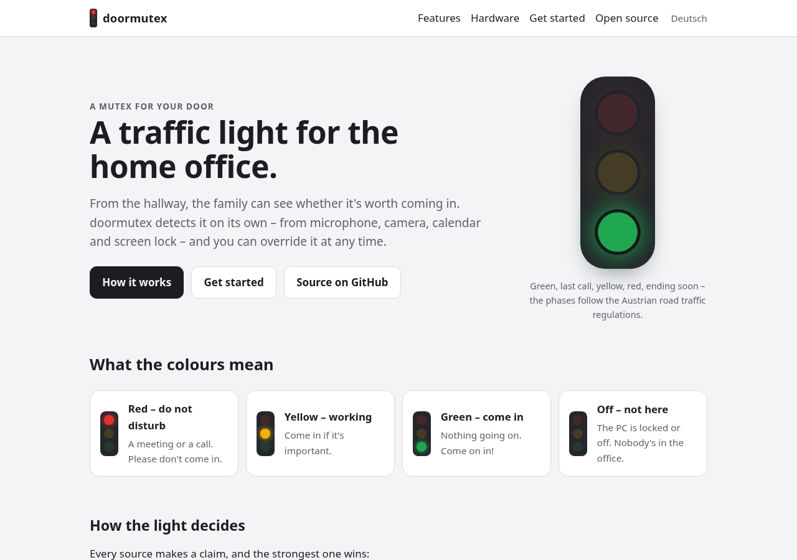

# doormutex-site

Website of [doormutex](https://github.com/padalton/doormutex) – *a mutex for your door*: an open-source traffic light for the home office.

A static site built with [Hugo](https://gohugo.io/), English (`/`) and German (`/de/`), to be hosted on Cloudflare Pages at **doormutex.org**.



## Principles

- **Nothing from other origins.** No web fonts, no CDN, no embeds, no analytics script – the system font stack and files from this repository only. CI fails if a page loads anything from another origin.
- **No JavaScript, no cookies.** The traffic-light animation is plain CSS and respects `prefers-reduced-motion`. A strict Content Security Policy (`script-src 'none'`) in [`static/_headers`](static/_headers) enforces it.
- **No cookie banner needed** – there is nothing to consent to. Statistics come only from Cloudflare's server-side traffic analytics.
- **Own theme** in [`layouts/`](layouts/) and [`assets/css/site.css`](assets/css/site.css): light and dark mode, mobile first, accessible.

## Structure

```
config/_default/hugo.toml        site config, languages, legal params
config/development/server.toml   the same CSP for `hugo server`
content/en/, content/de/         pages (same file name = translation)
i18n/                            UI strings
layouts/                         templates, partials, shortcodes
assets/                          CSS and screenshots (fingerprinted)
static/                          _headers (Cloudflare), icon
scripts/check_site.py            CI check: origins, inline code, links
```

## Develop

Hugo **0.169.0** (the standard edition is enough – no SCSS):

```bash
go install github.com/gohugoio/hugo@v0.169.0   # or a release binary
hugo server                                    # http://localhost:1313/
hugo --gc --minify && python3 scripts/check_site.py
```

`hugo server` sends the same Content Security Policy as production, so a violation shows up in the browser console. CI checks that both stay in sync.

## Before publishing: legal notice and privacy policy

1. Fill in `params.legal` in [`config/_default/hugo.toml`](config/_default/hugo.toml) – name, place of residence, e-mail. Until then the legal pages show a yellow placeholder, the build logs a warning, and the production build (`--panicOnWarning`) **refuses to build** – placeholders can't go live by accident.
2. Read the [legal notice](content/en/legal-notice.md) and the [privacy policy](content/en/privacy.md) (German: [Impressum](content/de/legal-notice.md), [Datenschutzerklärung](content/de/privacy.md)). **They are a starting point written without legal advice** – review them before publishing. They assume a non-commercial site of a private person in Austria (§ 25 MedienG). If the site ever sells something (kits, devices), the E-Commerce Act (§ 5 ECG) and more apply.
3. The privacy policy has a section on the software's use of Google user data with the Limited Use statement, as Google asks for when verifying the OAuth client. Its URL: `https://doormutex.org/privacy/#google`. If the software's Google access changes (scope, fields), update it.

## Deploy: Cloudflare Pages

Cloudflare Pages with its Git integration: Cloudflare builds every push itself, so **no secrets are needed in GitHub**, pull requests get preview deployments, and the `_headers` file is supported directly. (Workers static assets would work too, but need a `wrangler` config and gain nothing for a static site.)

1. **Domain:** buy `doormutex.org` at Cloudflare Registrar, so the zone is in the same account.
2. **Project:** *Workers & Pages → Create → Pages → Connect to Git* → allow the Cloudflare GitHub app access to `padalton/doormutex-site` only.
3. **Build settings:**

   | Setting | Value |
   |---|---|
   | Production branch | `main` |
   | Framework preset | Hugo |
   | Build command | `hugo --gc --minify --panicOnWarning` |
   | Build output directory | `public` |
   | Environment variable | `HUGO_VERSION` = `0.169.0` (Production and Preview) |

4. **Custom domains** (project → *Custom domains*): add `doormutex.org` and `www.doormutex.org`; Cloudflare creates the DNS records.
5. **www → apex:** *Rules → Redirect Rules → Create from template → "Redirect from WWW to root"* (301, keeps path and query).
6. **TLS:** *SSL/TLS → Edge Certificates*: *Always Use HTTPS* on, minimum TLS 1.2. HSTS comes from `_headers`; don't add the site to the preload list before it has been stable for a while.
7. **Keep Cloudflare from injecting scripts** – each of these would add JavaScript or third-party requests, and the CSP would block them anyway:
   - **Web Analytics** for the Pages project: **off** (it injects a JS beacon from `static.cloudflareinsights.com`). Use the zone's *Analytics & Logs → Traffic* instead – server-side, no cookies, nothing in the browser.
   - *Scrape Shield → Email Address Obfuscation*: **off** (it rewrites `mailto:` links with a script).
   - *Rocket Loader*, *Zaraz*, *Bot Fight Mode* / JavaScript detections: **off**.

Preview deployments on `*.pages.dev` get `X-Robots-Tag: noindex` from `_headers`.

## Licences

[REUSE](https://reuse.software/)-compliant, see [`REUSE.toml`](REUSE.toml):

- code (templates, styles, configuration, scripts): [Apache-2.0](LICENSES/Apache-2.0.txt)
- content (texts, images): [CC BY-SA 4.0](LICENSES/CC-BY-SA-4.0.txt)

The traffic-light icon (`static/icon.svg`, Apache-2.0) and the screenshots (`assets/images/`, CC BY-SA 4.0) come from the [doormutex](https://github.com/padalton/doormutex) project.
